<div align="center">

<picture>
  <source media="(prefers-color-scheme: dark)" srcset="./assets/banner-dark.svg" />
  <source media="(prefers-color-scheme: light)" srcset="./assets/banner-light.svg" />
  
</picture>

<br />

<p align="center">
  <a href="https://pypi.org/project/llm-drift-bench/">
    
  </a>
  <a href="https://github.com/Anantgoel0123456?tab=repositories">
    
  </a>
  
</p>

</div>

---

### About Me

- Building and maintaining **[`llm-drift-bench`](https://github.com/Anantgoel0123456/llm-drift-bench)** — a lightweight, offline CLI & Python library on PyPI for catching silent LLM regressions across model updates, prompt changes, and quantizations.
- Focused on **strictly typed Python**, **deterministic evaluation & schema verification**, **clean developer CLIs**, and **CI/CD regression gates**.
- Hands-on background across **Linux & Shell scripting**, **Android GSI / firmware porting tooling**, and **Dockerized Telegram & cloud automation bots**.
- Always open to collaborating on **open-source AI tooling, Python libraries, and developer infrastructure**.

---

### Featured Project — [`llm-drift-bench`](https://github.com/Anantgoel0123456/llm-drift-bench)

> **Catch silent regressions before you swap, update, or quantize your LLM.**

<p>
  <a href="https://pypi.org/project/llm-drift-bench/"></a>
  <a href="https://github.com/Anantgoel0123456/llm-drift-bench/actions/workflows/ci.yml"></a>
  <a href="https://github.com/Anantgoel0123456/llm-drift-bench"></a>
  <a href="https://github.com/Anantgoel0123456/llm-drift-bench"></a>
  <a href="https://github.com/Anantgoel0123456/llm-drift-bench/blob/main/LICENSE"></a>
</p>

- **100% Offline & Deterministic** — Compares captured baseline vs. candidate JSONL outputs with no LLM-as-a-judge API calls, no embedding downloads, and ~8 ms lazy package import.
- **JSON Schema & Drift Policies** — Enforces strict JSON extraction, duplicate-key & `NaN`/`Inf` rejection, per-field/wildcard `drift.toml` rules, and cross-prompt distribution shifts.
- **Built for CI/CD** — Ships native GitHub Actions Job Summaries, PR comments, JUnit XML, SARIF reports, and pluggable scorers (with optional OpenVINO GenAI & Opik integrations).

```bash
pip install llm-drift-bench
llm-drift-bench run -b baseline.jsonl -c candidate.jsonl --config drift.toml --github-summary
```

---

### Selected Repositories

| Project | What It Does | Stack |
| :--- | :--- | :--- |
| **[`llm-drift-bench`](https://github.com/Anantgoel0123456/llm-drift-bench)** | Offline LLM drift detection, JSON Schema conformity, multi-candidate ranking, statistical testing & agent tool-trace auditing. | `Python` · `PyPI` · `CLI` |
| **[`ErfanGSIs`](https://github.com/Anantgoel0123456/ErfanGSIs)** | Linux shell porting scripts for building Android Generic System Images (GSIs) from OEM and AOSP stock firmware. | `Shell` · `Linux` · `Android` |
| **[`gsibot`](https://github.com/Anantgoel0123456/gsibot)** | Automated workflow and bot tooling for orchestrating and dispatching Android GSI firmware builds. | `Automation` · `CI/CD` |
| **[`TG-Mirror-Bot`](https://github.com/Anantgoel0123456/TG-Mirror-Bot)** | Containerized Telegram automation bot for mirroring downloads and managing cloud transfers to Google Drive. | `Python` · `Docker` · `Aria2` |

---

### Tech Stack & Tooling

<div align="center">

<picture>
  <source media="(prefers-color-scheme: dark)" srcset="https://skillicons.dev/icons?i=py,bash,js,docker,linux,git,githubactions,vscode&theme=dark&perline=8" />
  <source media="(prefers-color-scheme: light)" srcset="https://skillicons.dev/icons?i=py,bash,js,docker,linux,git,githubactions,vscode&theme=light&perline=8" />
  
</picture>

</div>

<br />

| Area | Tools & Technologies |
| :--- | :--- |
| **Languages** | Python (`3.10+`), Bash / Shell, JavaScript, JSON / TOML / YAML |
| **AI Eval & Python** | Pydantic, Rich, Pytest, Strict Mypy, Ruff, Hatchling, OpenVINO GenAI, Opik |
| **Systems & Automation** | Linux, Docker, GitHub Actions, Git, Android GSI / AOSP Tooling, Telegram Bot APIs |

---

### GitHub Activity

<div align="center">
  <a href="https://github.com/Anantgoel0123456">
    <picture>
      <source media="(prefers-color-scheme: dark)" srcset="https://streak-stats.demolab.com?user=Anantgoel0123456&hide_border=false&background=0D1117&border=30363D&ring=38BDF8&fire=38BDF8&currStreakLabel=58A6FF&sideLabels=8B949E&currStreakNum=F0F6FC&sideNums=F0F6FC&dates=8B949E&stroke=21262D&border_radius=12" />
      <source media="(prefers-color-scheme: light)" srcset="https://streak-stats.demolab.com?user=Anantgoel0123456&hide_border=false&background=FFFFFF&border=D0D7DE&ring=0969DA&fire=0969DA&currStreakLabel=0969DA&sideLabels=57606A&currStreakNum=1F2328&sideNums=1F2328&dates=57606A&stroke=D8DEE4&border_radius=12" />
      
    </picture>
  </a>
  &nbsp;
  <a href="https://github.com/Anantgoel0123456">
    <picture>
      <source media="(prefers-color-scheme: dark)" srcset="https://github-readme-stats.vercel.app/api/top-langs/?username=Anantgoel0123456&layout=compact&card_width=320&hide_border=false&bg_color=0D1117&border_color=30363D&title_color=58A6FF&text_color=C9D1D9&border_radius=12&langs_count=6" />
      <source media="(prefers-color-scheme: light)" srcset="https://github-readme-stats.vercel.app/api/top-langs/?username=Anantgoel0123456&layout=compact&card_width=320&hide_border=false&bg_color=FFFFFF&border_color=D0D7DE&title_color=0969DA&text_color=24292F&border_radius=12&langs_count=6" />
      
    </picture>
  </a>
</div>

<br />

<div align="center">

<picture>
  <source media="(prefers-color-scheme: dark)" srcset="./assets/footer-dark.svg" />
  <source media="(prefers-color-scheme: light)" srcset="./assets/footer-light.svg" />
  
</picture>

</div>
